<a href="../../releases/latest">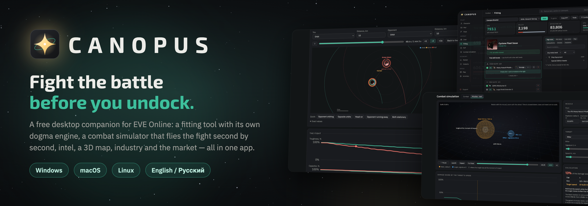</a>

<p align="center">
  <a href="../../releases/latest"></a>
  <a href="../../releases"></a>
  
  <a href="https://apps.apple.com/us/app/canopus-for-eve-online/id6829985678"></a>
  
</p>

<h3 align="center">
  <a href="../../releases/latest">Download for Windows</a> &nbsp;·&nbsp;
  <a href="../../releases/latest">macOS</a> &nbsp;·&nbsp;
  <a href="../../releases/latest">Linux</a> &nbsp;·&nbsp;
  <a href="https://apps.apple.com/us/app/canopus-for-eve-online/id6829985678">iPhone &amp; iPad</a>
</h3>

<p align="center">
  Free, no ads, no subscriptions. Nothing is sent to the developer. The macOS build is signed and notarized by Apple.
</p>

<p align="center">
  <a href="https://gercog1390.github.io/canopus-desktop/trailer.html">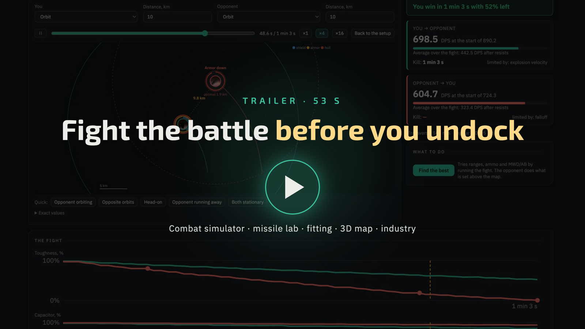</a>
</p>

## What makes Canopus different

<table>
<tr>
<td width="50%" valign="top">

### Fly the fight before you take it
Your fit against theirs, flown second by second: orbits with real inertia, reloads, capacitor, neuts, webs and scrams, the Reactive Armor Hardener adapting, boosters from the first second. Then watch the replay — and press **Find the best** to let Canopus try every range, ammo and prop module for you.

</td>
<td width="50%" valign="top">

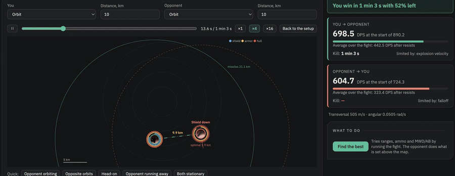

</td>
</tr>
<tr>
<td width="50%" valign="top">

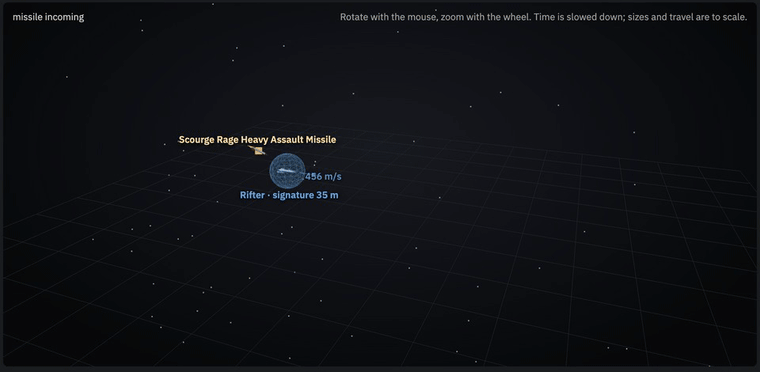

</td>
<td width="50%" valign="top">

### See why your missiles miss
Fire any missile at any ship in 3D: the blast grows at its explosion velocity while the target slips away, both to scale, with the game's formula and its numbers next to it. Signature, speed, explosion radius and velocity finally make sense.

</td>
</tr>
<tr>
<td width="50%" valign="top">

### Every number, live
Hover a module and every stat updates with the difference highlighted — before you fit it. A dogma engine of its own, checked against Pyfa 2.69.3 on 44 fits, with all 300 combat boosters in the game.

</td>
<td width="50%" valign="top">

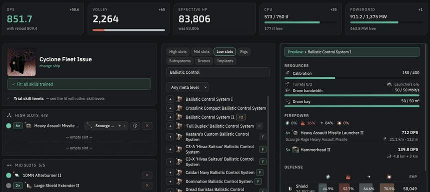

</td>
</tr>
</table>

## Canopus for iPhone and iPad

<a href="https://apps.apple.com/us/app/canopus-for-eve-online/id6829985678">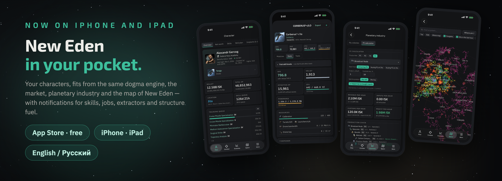</a>

Your characters, fits from the same dogma engine as the desktop app, the market, industry and planetary colonies, the map of New Eden, Thera and Turnur, incursions and faction warfare — with local notifications for skills, industry jobs, PI extractors, structure fuel and moon chunks. Free, no ads, English and Russian; much of it works without signing in.

**[Get it on the App Store](https://apps.apple.com/us/app/canopus-for-eve-online/id6829985678)** · iOS / iPadOS 26.5 or later

## New in 1.3

- **Combat simulator, now fought over time**, with a replay on the map and **Find the best**.
- **Boosters** — every combat booster, in the fitting tool and on both sides of a fight; tick the side effects that struck.
- **Missile lab** (test) — missile application in 3D.
- **Battle reports**, **wars** that concern you, and a **report from your own game log**.
- **Invention**, **production chains**, **ore for minerals**, **public contracts**, **price alerts**, **injectors and SP**, a **hauling plan**.
- **Net worth**, **wallet by day** with CSV, **mission agents**, a **mutaplasmid** calculator, **fleet vs doctrine**.
- A visual overhaul from top to bottom.

| Combat simulator | Missile lab | Fitting |
|---|---|---|
| 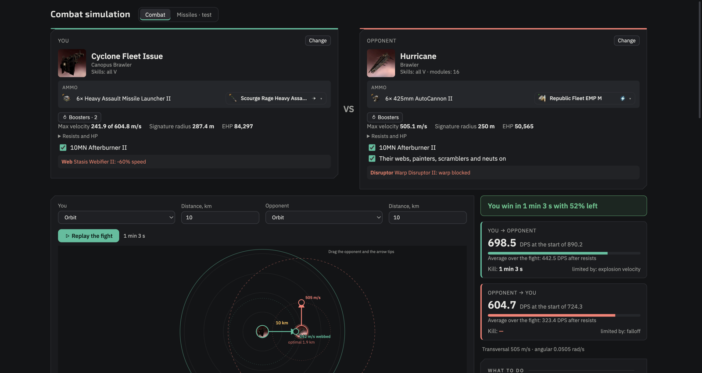 | 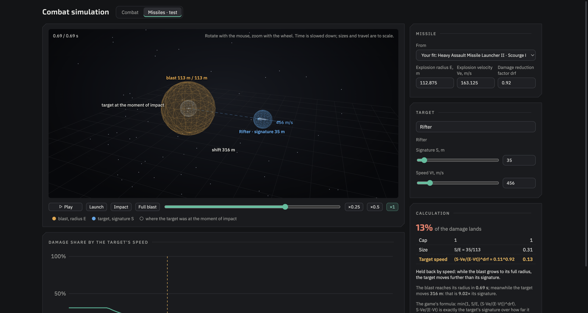 | 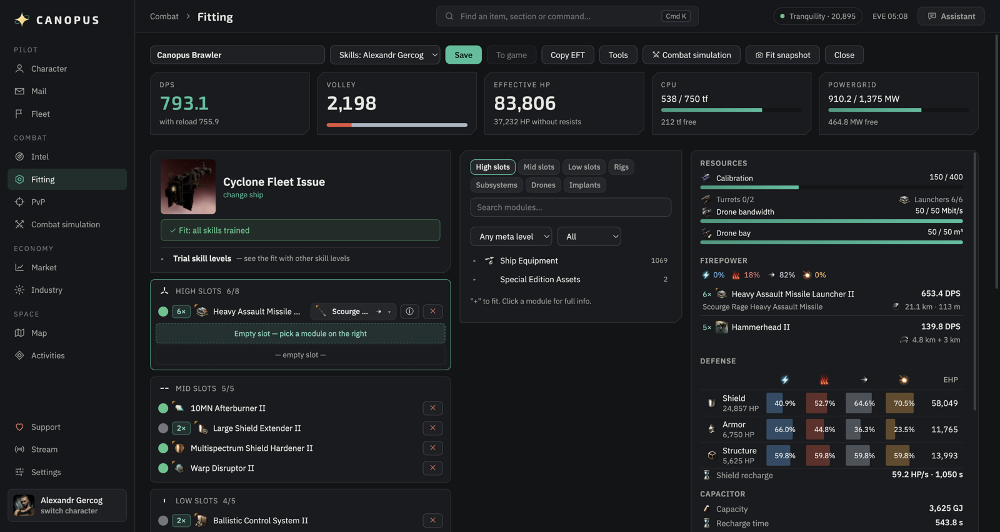 |

| Your character | Production chain | Wallet by day |
|---|---|---|
| 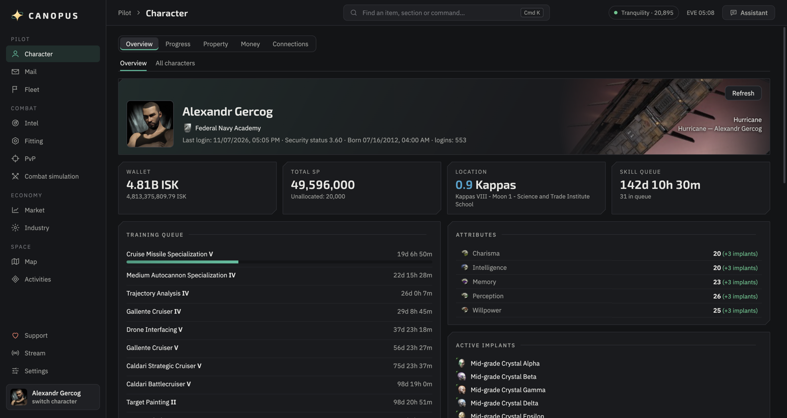 | 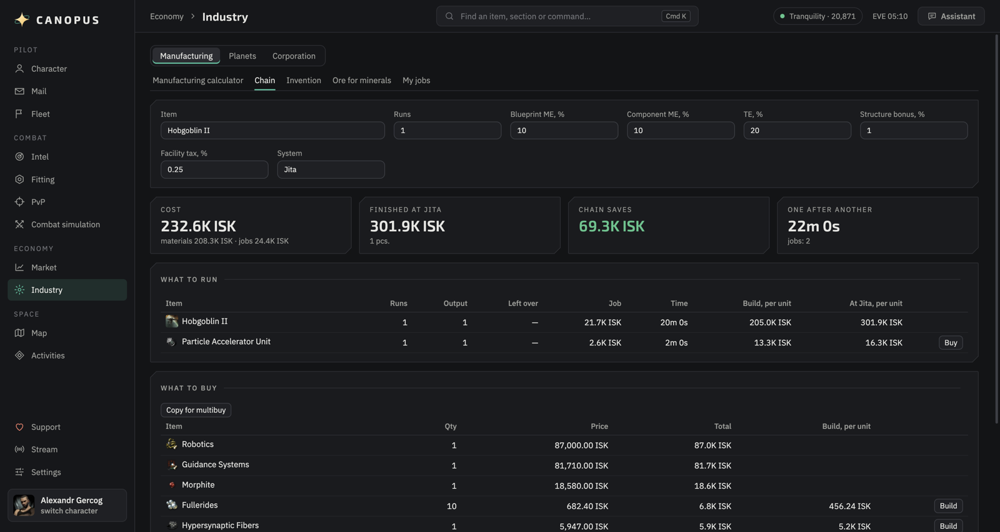 | 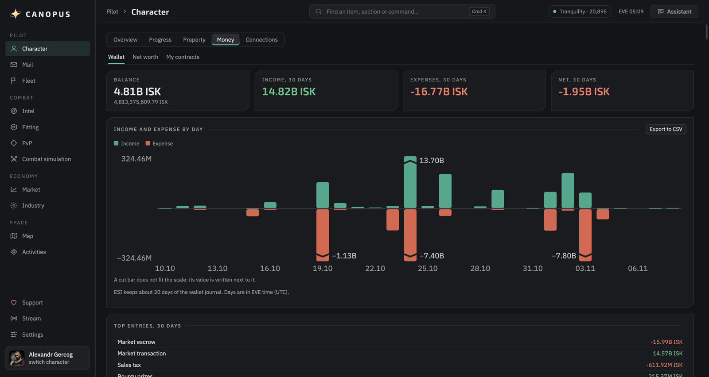 |

## Features

### A calm, fast interface
- A neutral graphite theme that is easy on the eyes during long sessions; one accent colour marks everything you can click. Pick the accent — Canopus, Photon, Amarr, Caldari, Gallente or Minmatar — and a comfortable or compact density.
- **Ctrl+K** from anywhere: jump to a section, open Show Info for any item, switch the overlay, language or theme.
- Live Tranquility player count and EVE time in the top bar.

### Fitting tool
- Dogma engine driven by CCP's Static Data Export: skills, hull and role bonuses, subsystems, modules (offline / online / active / overheated), charges, drones, implants and stacking penalties.
- Ship browser grouped by class and race, and a module browser grouped like the in-game market (shield, armor, propulsion, turrets by type…) with T1 / T2 / faction / deadspace / officer badges. Only modules that actually fit the ship are offered; turret and launcher hardpoints are enforced.
- The numbers you check first — DPS, volley, EHP, CPU and powergrid — are always on top; a nearly full powergrid turns amber.
- **Live preview**: hover a module in the list and every stat updates in place with the difference highlighted — compare without fitting.
- Identical modules collapse into one row ("6× Heavy Assault Missile Launcher II"): change state or ammo for all at once.
- Ammo picker grouped by tech level with damage-type icons.
- Firepower with damage profile; hover the DPS to see DPS with reload and the split between weapons and drones. EHP and resistances per layer, active tank, capacitor stability, navigation and targeting.
- Calculate with **all skills V** or with **your character's skills**: what to train and how long it takes.
- Fit cost at Jita prices, side-by-side fit comparison and **popular fits from zKillboard** for the same hull.
- Import / export EFT, open fits from your character, current ship, a killmail or Show Info — and **save a fit straight to your in-game fittings**.
- **Price optimizer**: the same stats for less ISK (cheaper versions of your modules that keep every number), or the upgrades that add the most to a chosen stat per million ISK within a budget.
- **Fit snapshot**: the whole fit and its stats on one picture, to copy or save as PNG.
- **Boosters**: all 300 combat boosters in the game (147 on the market), one per slot; the bonus always applies and you tick the side effects that struck.
- Tactical destroyer modes, Triglavian disintegrators (with spool-up), Vorton projectors, smartbombs, Bastion and siege modules, ancillary repairers and the reactive armor hardener. The engine was checked against Pyfa 2.69.3 on 44 fits, with no differences.

| Popular fits | Show Info |
|---|---|
| 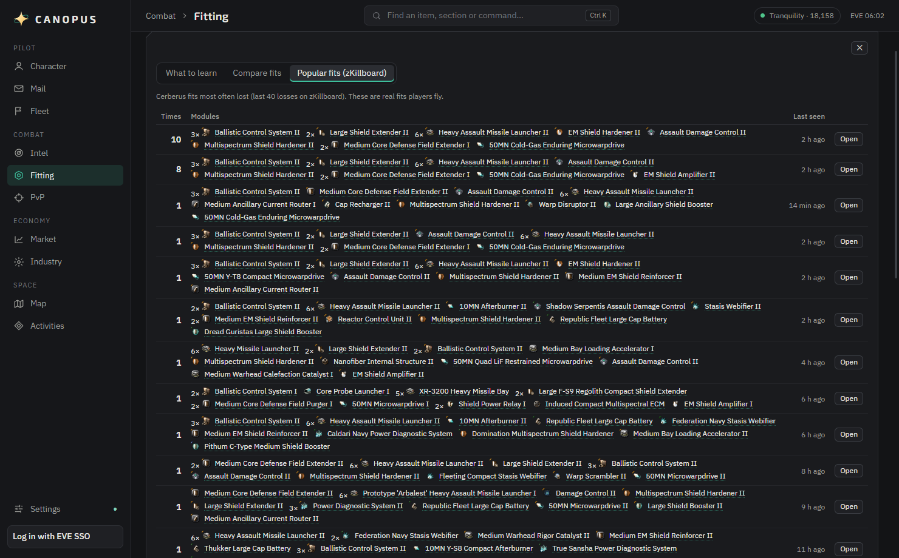 | 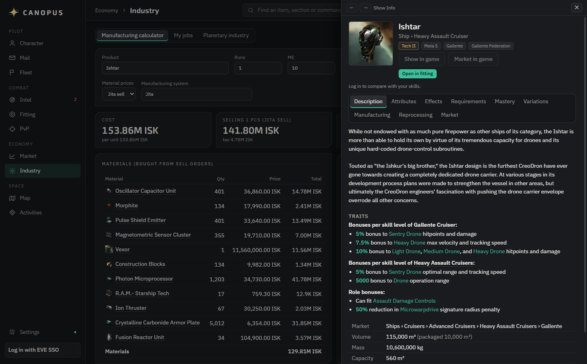 |

### Combat simulator
A separate window that pits your fit against an opponent — any saved fit, one of your in-game fits, an EFT paste or a bare hull.
- **The fight over time**: ships fly under orders (orbit, keep at range, approach, flee, stop or a course you drag on the map) with real inertia and turning; weapons cycle, reload and spool up; the capacitor drains and recharges; neutralizers and nosferatus bite; ancillary repairers run dry; the Reactive Armor Hardener adapts cycle by cycle; an assault damage control fires in bursts.
- **Replay** the fight on the map — shots, hit-point rings, events — with the toughness, capacitor and distance charts as the seek bar.
- Applied DPS for every weapon with the reason it's reduced (tracking, falloff, explosion radius or velocity), webs, painters, scrams and prop modules with their falloff and stacking penalties, and who dies first.
- **Find the best** tries ranges, flying modes, ammo and MWD/AB as real fights, offers the winner, shows how it holds if the opponent closes in or keeps away, and names what holds your fit back.
- **Boosters** on either side, acting from the first second. The **missile lab** shows missile application in 3D.

### PvP
- **Battle report** from zKillboard by a kill link, a system and time: both sides, what they flew and what they lost.
- **Wars** that are running and whether they concern you, read in portions so the shared ESI limit stays safe for everything else.
- **Report from your game log**: damage dealt and taken by weapon and opponent, hit rate and quality, peak DPS and remote repairs — and what stands out.
- **Kill radar**: kills from the zKillboard live feed near you and along your route — gate camps, bubbles, smartbombs — with a sound on danger.

### AI assistant (optional)
A chat panel (**Ctrl+J**) that answers from Canopus' own data instead of guessing: it looks at your characters, skills,
current ship fit, assets, wallet and trades, computes fits with the same engine as the fitting tool, compares ships by how
fast they clear a faction's mission rooms, plans skills, checks routes for recent kills, and opens fits and sections for you.
For mechanics, missions and patch changes it searches a local knowledge base (the EVE University wiki and CCP's patch
notes, downloaded to your computer), and the web only when that isn't enough, citing its sources.

It runs on OpenAI: **sign in with ChatGPT** (Plus or Pro — your plan pays, no separate bill) or use your own API key.
It is off until you set it up. The questions you ask and the data the assistant fetches to answer them (fits, skills,
prices, wallet, assets) are sent to OpenAI; your EVE login tokens and passwords never are. Actions in the game client
(setting a destination, saving a fit) always ask you first.

### Intel
- **Local scan** — press **Ctrl+A, Ctrl+C** in the Local window: every pilot is checked for corporation, alliance, age, kills and losses, danger ratio and favourite ships. Threat is shown as a meter with a word, not colour alone. New arrivals are highlighted, and when a dangerous pilot enters you get an alert in the app and a desktop notification.
- **Intel channels** — Canopus follows your alliance's intel chat logs, recognises systems (including shorthand like "1DQ") and ships in every report and shows how many jumps away they are; reports within your range raise an alert, "clr" / "nv" mean all clear.
- **D-scan and fleet window** analysis with warnings for interdictors, bombers, recons, logistics and capitals.
- An always-on-top **overlay** for windowed / borderless mode (**Ctrl+Shift+L** show / hide, **Ctrl+Shift+K** click-through), and small **mini-windows** over the game: timers of every character, a Jita price lookup, wallets.
- **Multi-client previews**: a live tile of every EVE client; click one or press a hotkey to bring that client to the front.
- **Alerts in Discord** — the same Local and intel-channel alerts posted to your channel through a webhook.

| Local scan | Intel channels | Overlay |
|---|---|---|
| 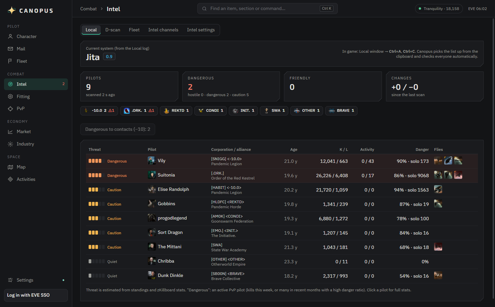 | 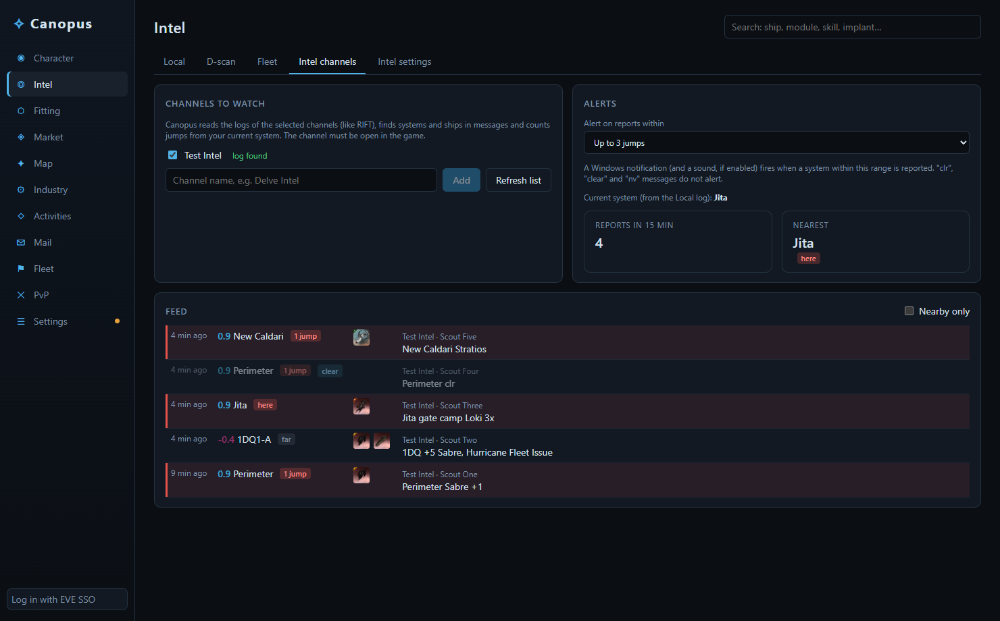 | 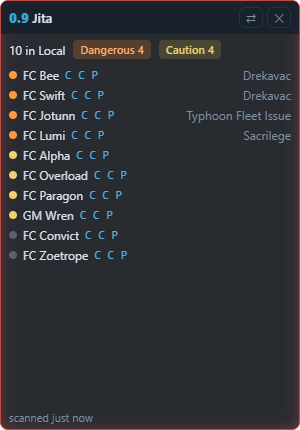 |

### 3D galaxy map
New Eden at the real coordinates from the SDE, rotate and zoom, region and system names, security colours and stargates.
- **Kills in the last hour** as a glow, **routes** (secure / shortest / low-null) drawn on the map with the busiest systems on the way, set in game with one click.
- **Alliance jump bridges (Ansiblex)** — paste the list (plain or Dotlan format), see them as arcs with their distance from the alliance capital (Cradle of War pricing), route through them.
- **Avoided systems** and **notes** per system; avoided systems are left out of every route.
- **Capital jump range** — a sphere around any system and every lowsec / nullsec system it reaches.
- **Sovereignty** — systems coloured by the alliance holding them, raidable Skyhooks and sovereignty timers marked.
- Fresh intel reports and your current system marked on the map.

| Galaxy | Sovereignty |
|---|---|
| 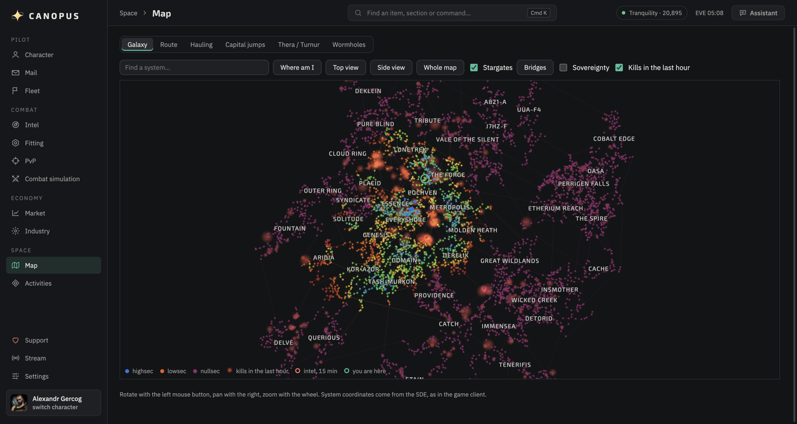 | 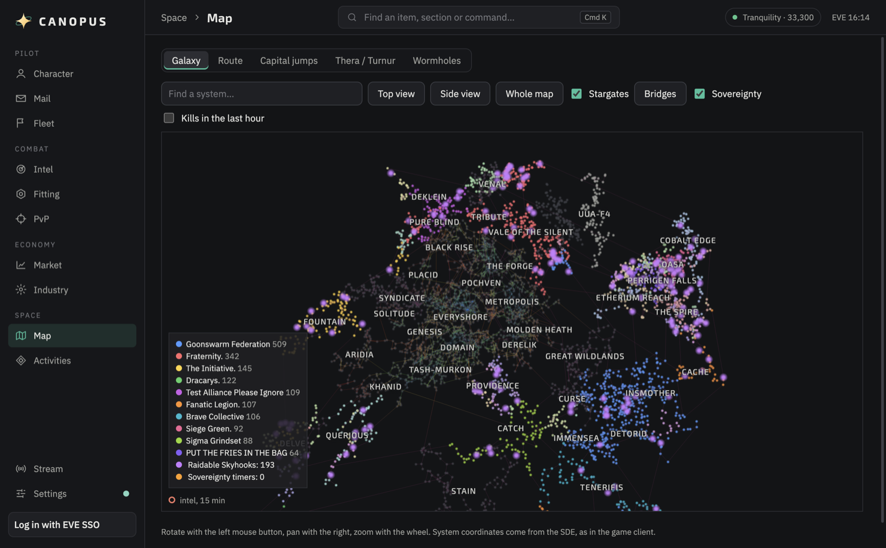 |

### Map and travel
- **Route safety** — every system on the route with security, ship / pod kills in the last hour and gate camps from zKillboard; set the destination in the game with one click.
- **Hauling plan** — a shopping list split into trips by hold size and ISK at risk, with the route's danger.
- **Jump planner** for capitals and black ops: range with your skills, fuel per jump and jump fatigue along a chain of cyno jumps.
- **Wormholes** — look up any hole type (class, lifetime, mass, max jump mass) and how many of your ships can pass. Thera / Turnur connections from EVE-Scout.

| Route safety | Jump planner | Wormholes |
|---|---|---|
| 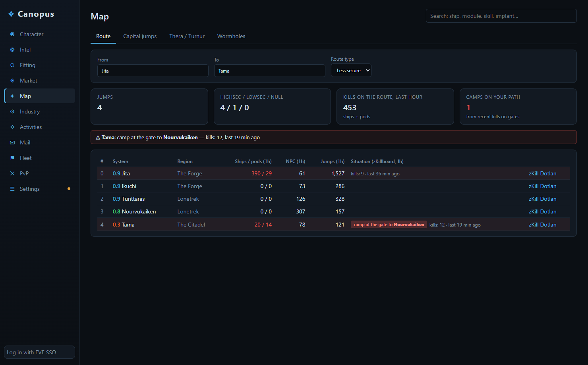 | 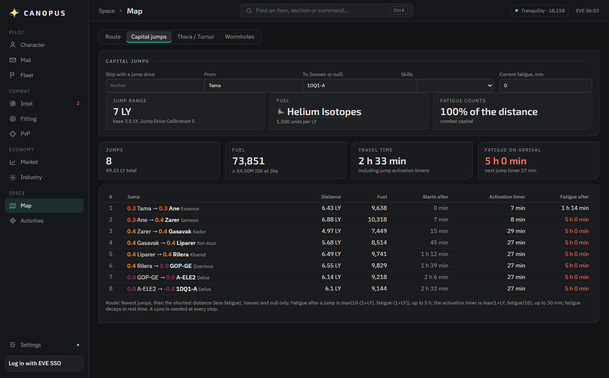 | 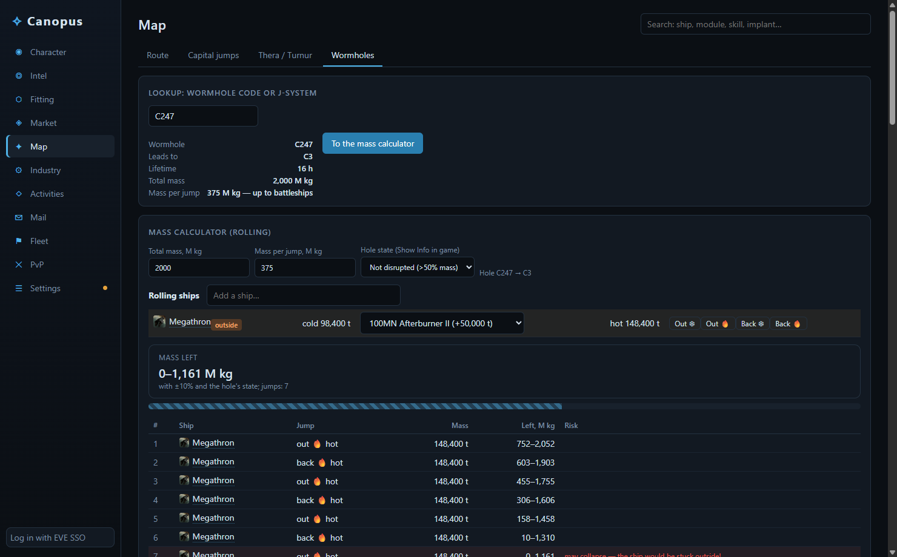 |

### Activities
- **Military Campaigns** — every faction campaign with its progress, the objectives with their rewards and your own contribution.
- **Freelance Jobs** — every public job with type, reward per unit, pool left and the jumps from you; filters the game doesn't have (any number of hidden corporations, minimum reward, within N jumps), alerts for new matching jobs; your jobs and your corporation's projects.
- **Signatures** — copy the probe scanner and Canopus remembers the signatures per system, marks new and vanished ones and tells what to expect at each site.
- **Ratting** — bounties from the wallet, damage dealt and received from the combat log.
- **Abyss** — a run log with results by tier and by ship.
- **Mining** — the mining ledger of all your characters for 30 days by ore, day, character or system, valued at Jita.

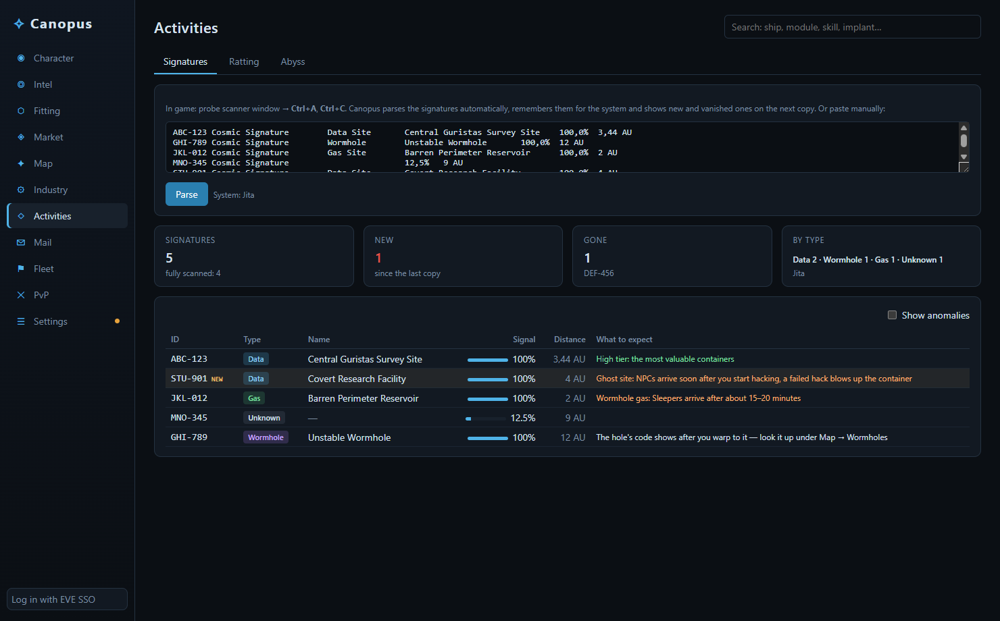

### Market and industry
- Market browser with the in-game category tree, prices in Jita, Amarr, Dodixie, Rens and Hek, the order book and 90-day history.
- **Arbitrage between trade hubs** by market category, with taxes, margin, volume and profit per m³.
- Loot appraisal (English or Russian names), LP store, your orders with outbid detection.
- **My trades**: real profit per item from your wallet (sales matched to earlier purchases), sales tax and broker fees.
- **Price alerts** at Jita — in the tray and optionally on Discord; **public contracts** that beat Jita; **injectors and SP**: what SP costs you and a skill-farm month.
- **Production chain**: everything an item takes, build or buy at each step, with a multibuy list. **Invention** with every decryptor compared. **Ore for minerals**: the cheapest compressed-ore mix for a mineral list.
- Manufacturing and reaction calculator (ME / TE, structure bonuses, system cost index, taxes), industry jobs and planetary colonies with extractor timers.
- **Corporation structures** — fuel, state with timers and services; alerts for low fuel, attacks, lost shields / armor (with the out-of-reinforce time) and finished moon extractions, also to Discord.
- **Moon mining** — refinery extraction timers and who mined what from your moons.

| Arbitrage | Market | Industry |
|---|---|---|
| 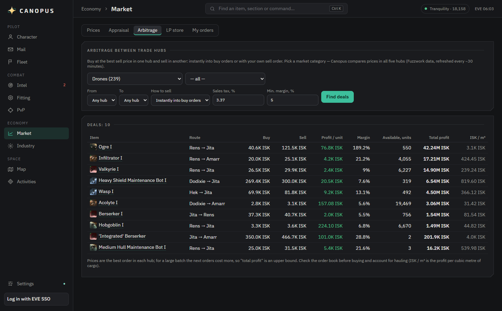 | 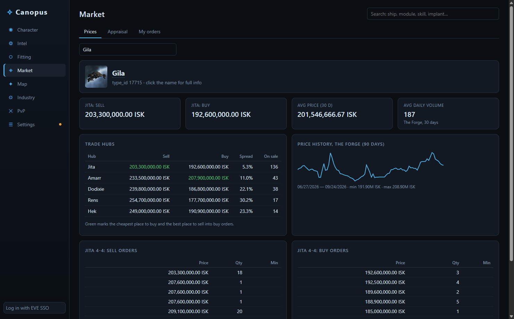 | 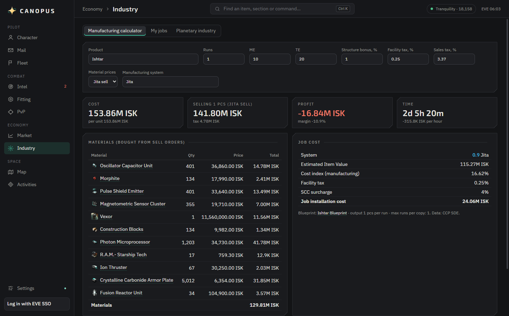 |

### Character, mail and fleet
- **All characters** on one screen: where they are and in what, skill queue, ISK, industry, PI, jump fatigue, clone jump.
- Overview, skill queue and a **skill planner** with the best remap or **two remaps** along a long plan, attributes with implants, jump clones, assets with Jita valuation, wallet, contracts, loyalty points, standings and jump fatigue.
- **Net worth**, the **wallet day by day** with CSV export, **mission agents** and a **mutaplasmid** calculator.
- **Blueprint library** across all characters: search by blueprint or by what it makes, ME / TE / runs, where it is.
- **Contacts**, **calendar**, **EVE mail** and **fleet** management — invite, move and kick members.
- **Fleet vs doctrine** — your fleet checked against a saved doctrine, hull by hull.
- **Doctrines** — paste a fleet's fits as EFT: who of your characters can fly each one and how long the rest need to train, the cost in Jita and a Multibuy list.
- **Tray and desktop notifications** for every character: skill queue running out, PI extractors, finished industry jobs, jump fatigue, outbid market orders, jump clone ready.
- zKillboard statistics and recent fights with the victim's fit.

### Streaming
Widgets for OBS (Browser source), served by Canopus on this computer only: your ship, the current system (optionally 2–60 minutes late, against stream sniping), the session's wallet change with kills and losses, and a killfeed from zKillboard.

### In-game actions (optional)
With your permission Canopus acts in the game through CCP's official ESI: opens the market, contract or info window,
sets the destination, saves fits, sends mail, edits contacts, manages the fleet and answers calendar events.
These permissions are requested only when you press **Settings → Allow in-game actions**; otherwise Canopus is read-only.
Corporation data (structures, structure notifications, moon mining) is opt-in the same way: **Settings → Allow corporation**; it needs the Station Manager / Accountant roles in game.

## Install

Download from [Releases](../../releases/latest):

- **Canopus-Setup-x.y.z.exe** — installer (Start menu and desktop shortcuts).
- **Canopus-x.y.z-portable.exe** — single file, no installation.
- **Canopus-x.y.z-mac.dmg** — macOS 12+ (Apple Silicon and Intel): open it and drag Canopus to Applications.
- **iPhone and iPad** — [Canopus for EVE Online on the App Store](https://apps.apple.com/us/app/canopus-for-eve-online/id6829985678) (iOS / iPadOS 26.5+), a separate mobile app.
- **Canopus-x.y.z-linux.AppImage** — Linux x64, any distribution: `chmod +x` and run. **Canopus-x.y.z-linux.deb** for Debian / Ubuntu.

The Windows, macOS and AppImage builds update themselves (the .deb is updated from the release page): Canopus checks GitHub for new versions, downloads them in the background (verified by SHA-256) and installs on restart. This can be turned off in **Settings → Updates**.

The Windows builds are not code-signed yet, so Windows SmartScreen may warn on first launch: click **More info → Run anyway**.

The macOS build is signed with a Developer ID and notarized by Apple, so it opens without warnings. Move Canopus to Applications and it updates itself like the Windows builds; shortcuts use **Cmd** instead of **Ctrl**.

On Linux Canopus finds the chat logs of EVE running under Steam's Proton or Wine automatically; for another location set the folder in **Intel → Settings**.

On first start Canopus downloads CCP's Static Data Export (~95 MB) and builds a local database; it updates itself when CCP publishes a new build. Game icons are fetched from CCP's image server on demand and cached.

## Getting started

1. **Log in with EVE SSO** (bottom left) — CCP's login page opens in your own browser, where you can check the login.eveonline.com address and certificate; Canopus never sees the page or your password. Canopus uses EVE SSO with PKCE; tokens are stored encrypted (Windows DPAPI / macOS Keychain / the Linux keyring) and never leave your computer. When a new version needs more permissions, Canopus asks you to log in again.
2. **Settings → Language** switches the interface and item names between English and Russian.
3. For intel, run EVE windowed or borderless, copy Local with **Ctrl+A, Ctrl+C** and choose your intel channels.

## Fair play

Canopus only uses official and player-visible data: CCP's ESI and SDE, the chat and game logs the client writes to your Documents folder, and what you copy to the clipboard yourself. It never reads the game client's memory and never automates input — the same approach as Pyfa or RIFT. The multi-client previews show the client windows the way the operating system's window switcher does and only bring a window to the front; no keys or clicks are sent to the game.

<details>
<summary><b>Verifying a download</b></summary>

Every release lists the **SHA-256 checksum** of each file in its notes and in `SHA256SUMS.txt`, with a VirusTotal link for each. To check a file:

- Windows (PowerShell): `Get-FileHash .\Canopus-Setup-x.y.z.exe`
- macOS / Linux: `shasum -a 256 Canopus-x.y.z-mac.dmg`

The macOS build is also signed with a Developer ID and notarized by Apple; Windows and Linux builds are made by GitHub Actions from the public source (`.github/workflows/build.yml`), so anyone can see how they were built.

</details>

<details>
<summary><b>Why the login asks for these permissions</b></summary>

Canopus reads only what each section needs. Everything stays on your computer; nothing is sent to the developer.

| Section | ESI permissions |
|---|---|
| Skills, planner, fitting with your skills | `esi-skills.read_skills.v1`, `esi-skills.read_skillqueue.v1` |
| Wallet, ratting, trades | `esi-wallet.read_character_wallet.v1` |
| Location, ship, online (intel, map, stream) | `esi-location.read_location.v1`, `esi-location.read_ship_type.v1`, `esi-location.read_online.v1` |
| Assets, structures names | `esi-assets.read_assets.v1`, `esi-universe.read_structures.v1`, `esi-search.search_structures.v1` |
| Industry, blueprints, mining, PI | `esi-industry.read_character_jobs.v1`, `esi-characters.read_blueprints.v1`, `esi-industry.read_character_mining.v1`, `esi-planets.manage_planets.v1` (read only) |
| Market orders, contracts | `esi-markets.read_character_orders.v1`, `esi-contracts.read_character_contracts.v1` |
| Clones, implants, fatigue, fittings | `esi-clones.read_clones.v1`, `esi-clones.read_implants.v1`, `esi-characters.read_fatigue.v1`, `esi-fittings.read_fittings.v1` |
| PvP, contacts, standings, loyalty points | `esi-killmails.read_killmails.v1`, `esi-characters.read_contacts.v1`, `esi-corporations.read_contacts.v1`, `esi-alliances.read_contacts.v1`, `esi-characters.read_standings.v1`, `esi-characters.read_loyalty.v1` |
| Military Campaigns, Freelance Jobs | `esi.activity.char:read`, `esi-characters.read_freelance_jobs.v1` |
| Set destination (only when you click) | `esi-ui.write_waypoint.v1` |

**Opt-in, only after you press the button in Settings:**

| Button | ESI permissions |
|---|---|
| Allow in-game actions | open windows in the client, save fits, mail, contacts, fleet, calendar (`esi-ui.open_window.v1`, `esi-fittings.write_fittings.v1`, `esi-mail.*`, `esi-characters.write_contacts.v1`, `esi-fleets.*`, `esi-calendar.*`) — Canopus acts only when you click |
| Allow corporation | structures, structure notifications, moon mining, corporation projects (`esi-corporations.read_structures.v1`, `esi-characters.read_notifications.v1`, `esi-industry.read_corporation_mining.v1`, `esi-corporations.read_projects.v1`) |

</details>

<details>
<summary><b>Building from source</b></summary>

Requires Node.js 22+. Builds are for your own noncommercial use; distributing them, or anything built on this code, is not allowed (see [License](#license)).

```bash
npm install
npm run dev        # development
npm run typecheck
npm run dist       # installer and portable .exe in release/
npm run dist:mac   # dmg and zip (signing needs a Developer ID)
npm run dist:linux # AppImage and .deb
```

Stack: Electron, electron-vite, React, TypeScript.

- `src/main` — Electron main process: HTTP cache, EVE SSO, SDE pipeline (`sde/`), dogma engine and combat model (`dogma/`), log and clipboard watchers, notifications, overlay.
- `src/renderer` — React UI; `i18n/` translates the interface on render.
- `src/shared` — types shared across processes.

Questions and ideas: [Discussions](../../discussions) · bug reports: [Issues](../../issues) — also from **Settings → Help and feedback** in the app.

</details>

## Data sources

[ESI](https://developers.eveonline.com/) and the Static Data Export (CCP Games) · [zKillboard](https://zkillboard.com/) · [EVE-Scout](https://www.eve-scout.com/) · [Fuzzwork Market](https://market.fuzzwork.co.uk/) · [EVE University wiki](https://wiki.eveuniversity.org/) (CC BY-SA 4.0, for the assistant's knowledge base) · CCP news and patch notes

## License

[PolyForm Strict 1.0.0](LICENSE): you may use Canopus for any noncommercial purpose and read its source, but not distribute it, change it or build new works on it. Versions up to and including 1.2.0 were published under the MIT License. The Canopus name and logo are not licensed.

Bug reports and ideas are very welcome in [Issues](../../issues) and [Discussions](../../discussions); code contributions only by arrangement.

EVE Online and all related materials are trademarks or property of CCP hf. Canopus is a third-party application and is not affiliated with or endorsed by CCP hf.
